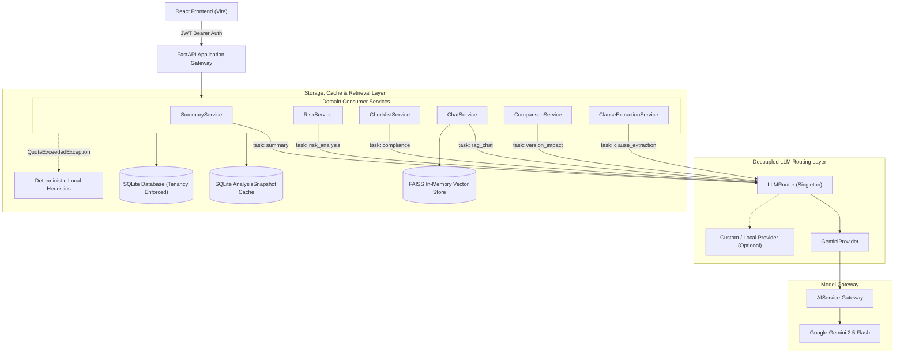

# ClauseIQ: Contract Analysis Platform

ClauseIQ is a high-assurance document analysis and contract intelligence platform. It combines Retrieval-Augmented Generation (RAG), vector similarity search, string metric diffing, and deterministic heuristic fallbacks to parse legal agreements, extract structured clauses, evaluate compliance checklists, quantify risks, and analyze contract version diffs.

---

## Core Capabilities

*   **Document Ingestion & Chunking:** Parses PDF contracts into page-indexed text chunks, generating dense vector embeddings via Google Generative AI embeddings (`models/gemini-embedding-2`) and indexing them in a localized FAISS store.
*   **Decoupled LLM Task Router:** Dispatches all text and structured generation requests through an abstracted routing layer (`LLMRouter`) across 6 registered tasks (`summary`, `risk_analysis`, `compliance`, `rag_chat`, `version_impact`, `clause_extraction`).
*   **Structured Analysis Pipelines:**
    *   **Executive Summaries:** Produces structured contract metadata, key obligations, governing law, and parties.
    *   **Compliance Verification:** Evaluates contracts against standard corporate provisions (Termination, Confidentiality, Indemnification, Governing Law, Force Majeure).
    *   **Risk Assessment:** Categorizes liabilities into High, Medium, and Low risk tiers with grounded source text citations.
*   **Automated Clause Extraction:** Segments raw document text into distinct, addressable clauses mapped to original page and section boundaries.
*   **Cost-Optimized Version Comparison:** Compares contract revisions using RapidFuzz string metric distance:
    *   *Unchanged Clauses (>=98% match):* Resolved deterministically at zero model cost.
    *   *Modified Clauses (80-97% match):* Routed to LLM with `task="version_impact"` to assess compliance and risk exposure.
    *   *Added / Removed Clauses:* Categorized via local structural diffing.
*   **Context-Scoped RAG Chat:**
    *   *Vector Retrieval:* Nearest-neighbor query in FAISS.
    *   *Tenant Scoping:* Hard-filters candidates by `document_id` and authenticated `user_id`.
    *   *Hybrid Reranking:* Reranks candidates using combined semantic vector similarity (0.7 weight) and Jaccard token overlap (0.3 weight).
    *   *Citation Synthesis:* Returns grounded answers with explicit page and section citations.
*   **Dual-Layer Resilience & Snapshot Caching:**
    *   *Snapshot Cache:* Persists LLM responses in SQLite keyed by `(document_id, analysis_type, content_hash, user_id)`. Subsequent requests return instantly without model invocation.
    *   *Deterministic Fallbacks:* On HTTP 429/503 or quota exhaustion (`QuotaExceededException`), services fall back to local rule-based heuristics and regex parsers.
*   **Multi-Format Export:** Generates downloadable audit reports in PDF (`reportlab`), DOCX (`python-docx`), and structured JSON.

---

## System Architecture



---

## LLM Router & Task Contracts

All generation passes through [`LLMRouter`](backend/app/services/llm_router.py). Consumer services do not import or reference model clients directly.

### Task Routing Table

| Task Identifier | Output Contract | Default Provider | Deterministic Quota Fallback |
| :--- | :--- | :--- | :--- |
| `summary` | Structured `dict` | `GeminiProvider` | Extractive chunk sampling across document pages |
| `risk_analysis` | Structured `dict` | `GeminiProvider` | Keyword rules (`liability`, `punitive damages`, `indemnity`) |
| `compliance` | Structured `list[dict]` | `GeminiProvider` | 5-point keyword compliance checklist |
| `rag_chat` | Plain text `str` | `GeminiProvider` | Offline notification retaining retrieved citations |
| `version_impact` | Structured `dict` | `GeminiProvider` | Offline comparison impact summary |
| `clause_extraction` | Structured `list[dict]` | `GeminiProvider` | Regex section header boundary splitting |

### Architectural Boundary: Representation vs. Generation

ClauseIQ maintains a strict boundary between embedding/retrieval and generation:
*   **Representation & Vector Search:** Owned by `EmbeddingService` and `FAISSVectorStore` using `GoogleGenerativeAIEmbeddings`. Multi-tenant scoping and flat-index vector pruning operate independently of the generation router.
*   **Generation:** Owned by `LLMRouter`. Consumer services specify task intent; providers return parsed objects or text.

### Extending with Alternative Providers

To integrate an alternative provider (e.g. self-hosted Ollama, legal foundation model, or private cloud endpoint):

1. Implement the `LLMProvider` protocol (`backend/app/services/llm_providers/base.py`):
```python
from typing import Any
from app.services.llm_providers.base import LLMProvider

class CustomLegalProvider:
    async def generate_text(
        self, prompt: str, *, task: str, user_id: str | None = None, **options: Any
    ) -> str:
        # Call custom endpoint for unstructured text
        ...

    async def generate_json(
        self, prompt: str, *, task: str, user_id: str | None = None, **options: Any
    ) -> Any:
        # Call custom endpoint and return parsed dict/list
        ...
```

2. Register the provider and configure task routes:
```python
from app.services.llm_router import LLMRouter
from app.services.llm_providers.gemini_provider import GeminiProvider

custom_provider = CustomLegalProvider()

router = LLMRouter(
    providers={
        "gemini": GeminiProvider(),
        "custom_legal": custom_provider,
    },
    task_routes={
        "summary": "gemini",
        "risk_analysis": "custom_legal",
        "compliance": "custom_legal",
        "rag_chat": "gemini",
        "version_impact": "custom_legal",
        "clause_extraction": "gemini",
    },
)
```

---

## Multi-Tenant Security & Isolation

*   **JWT Authentication:** All protected endpoints require a validated JWT token injected via FastAPI's `Depends(get_current_user)`.
*   **Repository-Level Scoping:** All database operations (`DocumentRepository`, `ChunkRepository`, `ClauseRepository`, `SnapshotRepository`, `ActivityRepository`, `MetricsRepository`) enforce mandatory `user_id` predicates. Cross-tenant access attempts raise HTTP 404 or authorization errors.
*   **Vector Search Tenant Isolation:** In-memory FAISS searches post-filter candidates strictly by `(document_id, user_id)` before reranking, preventing vector leakage across tenants.
*   **Index Pruning on Document Deletion:** When a document is deleted, vectors are pruned directly from the index using flat array reconstruction (`reconstruct`) and index rebuilding without re-embedding.

---

## API Reference

| Method | Endpoint | Description | Auth Required |
| :--- | :--- | :--- | :--- |
| `POST` | `/api/auth/register` | Register new user account | No |
| `POST` | `/api/auth/login` | Authenticate and obtain JWT access token | No |
| `GET` | `/api/auth/me` | Fetch active user profile | Yes |
| `POST` | `/api/documents/upload` | Upload PDF document, extract text chunks, index vectors | Yes |
| `GET` | `/api/documents` | List uploaded documents for authenticated user | Yes |
| `GET` | `/api/documents/{id}` | Retrieve document metadata and chunks | Yes |
| `DELETE` | `/api/documents/{id}` | Delete document, chunks, snapshots, and prune FAISS vectors | Yes |
| `POST` | `/api/analysis/{id}/summary` | Generate or retrieve cached executive summary | Yes |
| `POST` | `/api/analysis/{id}/risks` | Generate or retrieve cached risk analysis | Yes |
| `POST` | `/api/analysis/{id}/checklist` | Generate or retrieve cached compliance checklist | Yes |
| `POST` | `/api/chat/{id}` | Ask question against document via RAG with citations | Yes |
| `POST` | `/api/compare` | Compare two document versions using RapidFuzz + LLM | Yes |
| `GET` | `/api/export/{id}/{format}` | Export report (`pdf`, `docx`, `json`) | Yes |
| `GET` | `/api/activity` | Retrieve user audit trail and activity log | Yes |
| `GET` | `/api/metrics` | Retrieve cache hit/miss and execution metrics | Yes |

---

## Technology Stack

*   **Backend Framework:** Python 3.12, FastAPI, Pydantic v2, Uvicorn.
*   **Persistence & Database:** SQLAlchemy 2.0, SQLite (WAL mode).
*   **Vector Search & Embeddings:** FAISS (`faiss-cpu`), Google Generative AI Embeddings (`models/gemini-embedding-2`).
*   **LLM Gateway:** Google Gemini 2.5 Flash, `google-genai`.
*   **Diffing & Metrics:** RapidFuzz (Levenshtein / partial ratio string metrics).
*   **Document Processing:** PyPDF, `python-docx`, ReportLab.
*   **Frontend Interface:** React 18, Vite, Framer Motion, GSAP, Anime.js, Axios, Lucide Icons.
*   **Testing Infrastructure:** Pytest, AnyIO, unittest.mock, Starlette TestClient.

---

## Test Suite Architecture

The backend test suite contains **55 automated tests** validating router mechanics, provider independence, multi-tenant security, and heuristic resilience:

```text
tests/
├── test_phase6b.py                   # 6 tests: Multi-tenant isolation, FAISS vector pruning, audit logging
├── test_llm_router.py                # 13 tests: LLMRouter core, validation, provider swapping, multi-provider routing
├── test_llm_provider_independence.py # 13 tests: Protocol compliance, 6-task dispatch, QuotaExceeded propagation
├── test_summary_router.py            # 3 tests: SummaryService routing, snapshot caching, fallback
├── test_risk_router.py               # 4 tests: RiskService routing, keyword rule fallback, snapshot caching
├── test_checklist_router.py          # 5 tests: ChecklistService routing, 5-point keyword fallback, caching
├── test_chat_router.py               # 3 tests: ChatService RAG retrieval, hybrid reranking, citation metadata
├── test_version_impact_router.py     # 4 tests: RapidFuzz categorization and ChangeAnalysisService routing
└── test_clause_extraction_router.py  # 4 tests: ClauseExtractionService routing and regex header fallback
```

---

## Getting Started

### Prerequisites

*   Python 3.10+ (tested on Python 3.12)
*   Node.js 18+ & npm
*   Google Gemini API Key

### 1. Repository Setup

```bash
git clone https://github.com/Dr-Venom29/ClauseIQ.git
cd ClauseIQ/clauseiq
```

### 2. Backend Installation

```powershell
cd backend
python -m venv venv
.\venv\Scripts\Activate.ps1
pip install -r requirements.txt
```

Create a `.env` file in `backend/`:
```env
GEMINI_API_KEY=your_gemini_api_key_here
JWT_SECRET_KEY=generate_a_random_32_byte_hex_string
JWT_ALGORITHM=HS256
ACCESS_TOKEN_EXPIRE_MINUTES=60
DATABASE_URL=sqlite:///./test.db
```

### 3. Frontend Installation

```bash
cd ../frontend
npm install
```

### 4. Running Locally

**Start Backend:**
```powershell
cd backend
uvicorn app.main:app --reload --port 8000
```
API Documentation: `http://localhost:8000/docs`

**Start Frontend:**
```bash
cd frontend
npm run dev
```
Client Interface: `http://localhost:5173`

### 5. Running Verification Tests

```powershell
cd backend
python -m pytest -q
```

---

## License

Proprietary. All rights reserved.
