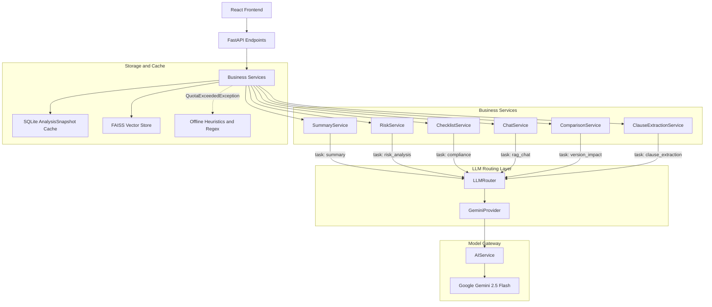

# ClauseIQ: Contract Analysis Platform

ClauseIQ is a document analysis and contract intelligence platform. It uses Retrieval-Augmented Generation (RAG), vector search, and heuristic fallbacks to parse legal documents, extract clauses, generate compliance checklists, identify risks, and compare contract versions.

---

## Core Capabilities

*   **Document Ingestion:** Parses PDFs into page-level chunks and indexes text embeddings using FAISS and Google Generative AI embeddings (`models/gemini-embedding-2`).
*   **LLM Task Routing:** Routes all generation requests through a decoupled router (`LLMRouter`) with explicit task definitions (`summary`, `risk_analysis`, `compliance`, `rag_chat`, `version_impact`, `clause_extraction`).
*   **Structured Analysis:**
    *   **Summaries:** Generates structured executive summaries and obligations.
    *   **Compliance Checklists:** Evaluates documents against standard business requirements (e.g., Termination, Confidentiality, Indemnification, Governing Law, Force Majeure).
    *   **Risk Analysis:** Categorizes High, Medium, and Low risks with citations back to the source text.
*   **Clause Extraction:** Identifies and segments contract clauses mapped to source page numbers.
*   **Contract Version Comparison:** Compares two contract versions using a `rapidfuzz` string similarity engine. Unchanged clauses (>=98% match) and structural changes are separated locally; modified clauses (80-97% match) are sent to the LLM to assess compliance and risk impact.
*   **Context-Aware RAG Chat:**
    *   *Candidate Retrieval:* Queries FAISS for candidates using vector similarity.
    *   *Metadata Scoping:* Restricts retrieved chunks strictly to the active `document_id` and authorized `user_id`.
    *   *Hybrid Reranking:* Reranks candidates using semantic similarity (0.7 weight) and Jaccard token overlap (0.3 weight).
    *   *Citation Synthesis:* Returns grounded answers with source page and section citations.
*   **Offline Resilience & Caching:**
    *   *Snapshot Caching:* Analysis results are stored in SQLite (`AnalysisSnapshot`). Repeated queries return cached snapshots without model invocation.
    *   *Heuristic Fallbacks:* When API quota limits (HTTP 429/503) or rate limits occur, the system falls back to deterministic regex extraction and keyword heuristics.
*   **Workspace & Audit Logging:** Tracks document lineage, user actions (`upload`, `summary`, `risk_analysis`, `checklist`, `chat`, `comparison`), and cache metrics.
*   **Multi-Format Export:** Generates downloadable reports in PDF, DOCX, and JSON formats.

---

## Architecture & LLM Routing

ClauseIQ decouples business services from model providers using a provider adapter pattern:



### Task Mapping

| Task Identifier | Default Provider | Output Format | Offline Fallback |
| :--- | :--- | :--- | :--- |
| `summary` | Gemini | JSON (`dict`) | Extractive chunk sampling |
| `risk_analysis` | Gemini | JSON (`dict`) | Keyword rules (`liability`, `punitive damages`) |
| `compliance` | Gemini | JSON (`list[dict]`) | 5-point keyword checklist |
| `rag_chat` | Gemini | Text (`str`) | Quota error notice with citations |
| `version_impact` | Gemini | JSON (`dict`) | Offline comparison impact summary |
| `clause_extraction` | Gemini | JSON (`list[dict]`) | Regex header splitting |

---

## Multi-Tenant Security & Data Isolation

*   **Request Authentication:** Endpoints require JWT validation via `Depends(get_current_user)`.
*   **Database Isolation:** All primary records (`Document`, `Chunk`, `Clause`, `AnalysisSnapshot`, `ActivityLog`, `Metrics`) enforce `user_id` foreign keys. Repository queries filter by caller identity.
*   **Vector Search Isolation:** In-memory vector searches filter results post-query by both `document_id` and `user_id` to prevent cross-tenant vector leakage.
*   **Offline Vector Deletion:** When a document is deleted, vectors are pruned directly from the index using flat array reconstruction (`reconstruct`) and index rebuilding without re-embedding.

---

## Technology Stack

*   **Backend:** Python 3.12, FastAPI, SQLAlchemy, SQLite, FAISS (`faiss-cpu`), `google-genai`, `rapidfuzz`, `python-docx`, `reportlab`, `pydantic-settings`.
*   **Frontend:** React 18, Vite, Framer Motion, GSAP, Anime.js, Axios.
*   **Testing:** Pytest, unittest.mock, HTTPX TestClient.

---

## Setup & Installation

### Prerequisites
*   Python 3.10+
*   Node.js 18+
*   Google Gemini API Key

### 1. Repository Setup
```bash
git clone https://github.com/yourusername/clauseiq.git
cd clauseiq
```

### 2. Backend Setup
Create and activate a virtual environment:

**Windows (PowerShell):**
```powershell
cd backend
python -m venv venv
.\venv\Scripts\Activate.ps1
pip install -r requirements.txt
```

**Linux / macOS:**
```bash
cd backend
python3 -m venv venv
source venv/bin/activate
pip install -r requirements.txt
```

Create a `.env` file in the `backend/` directory:
```env
GEMINI_API_KEY=your_gemini_api_key_here
JWT_SECRET_KEY=replace_with_a_secure_random_key
JWT_ALGORITHM=HS256
ACCESS_TOKEN_EXPIRE_MINUTES=60
DATABASE_URL=sqlite:///./test.db
```

### 3. Frontend Setup
```bash
cd ../frontend
npm install
```

---

## Running the Application

### Start Backend Server
From the `backend/` directory with the virtual environment activated:
```bash
uvicorn app.main:app --reload
```
The API is available at `http://localhost:8000` with interactive docs at `http://localhost:8000/docs`.

### Start Frontend Server
From the `frontend/` directory:
```bash
npm run dev
```
The interface is available at `http://localhost:5173`.

---

## Running Tests

From the `backend/` directory:

```bash
# Run full test suite
python -m pytest -q

# Run specific test suites
python -m pytest tests/test_llm_router.py -q
python -m pytest tests/test_summary_router.py -q
python -m pytest tests/test_risk_router.py -q
python -m pytest tests/test_checklist_router.py -q
python -m pytest tests/test_chat_router.py -q
python -m pytest tests/test_phase6b.py -q
```

---

## Project Structure

```text
clauseiq/
├── backend/
│   ├── app/
│   │   ├── api/routes/         # FastAPI endpoints (auth, chat, comparison, documents, etc.)
│   │   ├── core/               # Configuration, security, JWT, and exceptions
│   │   ├── db/                 # Database engine and session lifecycle
│   │   ├── models/             # SQLAlchemy ORM models
│   │   ├── repositories/       # Data access layer isolating database queries
│   │   ├── schemas/            # Pydantic request/response models
│   │   ├── services/           # Business logic
│   │   │   ├── llm_router.py   # LLM task router
│   │   │   ├── llm_providers/  # Provider adapter implementations
│   │   │   ├── ai_service.py   # Gemini API client gateway
│   │   │   ├── chat_service.py # RAG chat implementation
│   │   │   └── ...             # Summary, risk, checklist, comparison services
│   │   ├── storage/            # File storage abstraction layer
│   │   └── vector_store/       # FAISS vector store abstraction
│   ├── tests/                  # Integration, unit, security, and router test suites
│   ├── requirements.txt        # Backend dependencies
│   └── test.db                 # Local SQLite database
└── frontend/
    ├── src/
    │   ├── components/         # React views, layout shells, and UI components
    │   ├── App.jsx             # Root application component
    │   └── main.jsx            # Entry point
    ├── package.json
    └── vite.config.js
```

---

## License

Proprietary. All rights reserved.
